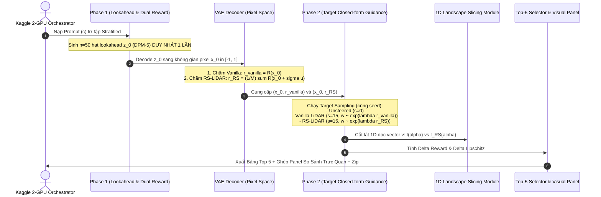

# Implementation Plan: Ablation 1 - Sensitive Prompt Analysis & Non-Lipschitz Landscape Slicing

> **Dự án**: RS-LiDAR: Randomized Smoothing Lookahead Guidance for Test-Time Scaling of Diffusion Models  
> **Chuyên đề**: Ablation Study 1 (Case Study Phân Tích Prompt Nhạy Cảm & Cắt Lát Bề Mặt Reward Phi Lipschitz)  
> **Nền tảng tối ưu**: Kaggle 2x GPU Tesla T4 (Song song Shard 0/1) & Google Colab Pro+  
> **Tệp mẫu kiến trúc**: [`kaggle/RS_LiDAR_Lipschitz_Test_Kaggle.ipynb`](kaggle/RS_LiDAR_Lipschitz_Test_Kaggle.ipynb) và [`test_empirical_lipschitz.py`](test_empirical_lipschitz.py)  

> [!CAUTION]
> **NGUYÊN TẮC BẤT BIẾN (STRICT INVIOLABLE RULE)**:
> **TUYỆT ĐỐI CẤM SỬA BẤT KỲ FILE NÀO TRONG THƯ MỤC `fkd_diffusers/`!**
> Các file trong `fkd_diffusers/` (như `fkd_pipeline_sd.py`, `fkd_pipeline_sdxl.py`, `rewards.py`, `image_reward_utils.py`) chỉ được phép **ĐỌC VÀ IMPORT** (Read-Only). Mọi logic mới của Ablation 1 phải được đóng gói độc lập trong `test_sensitive_prompt_landscape.py` và notebook Kaggle.

---

## 📑 Mục Lục
1. [Bối Cảnh & Mục Tiêu Nghiên Cứu](#1-bối-cảnh--mục-tiêu-nghiên-cứu)
2. [Học Tập Kiến Trúc Môi Trường & 2 GPU Sharding Từ 2 File Mẫu](#2-học-tập-kiến-trúc-môi-trường--2-gpu-sharding-từ-2-file-mẫu)
3. [Cơ Chế Sinh 2-Phase: Phase 1 Lookahead & Phase 2 Target Steering](#3-cơ-chế-sinh-2-phase-phase-1-lookahead--phase-2-target-steering)
4. [Phương Pháp Cắt Lát Bề Mặt 1D/2D (Landscape Slicing)](#4-phương-pháp-cắt-lát-bề-mặt-1d2d-landscape-slicing)
5. [Cơ Chế Xếp Hạng Sorting & Trích Xuất Top 5 Chênh Lệch](#5-cơ-chế-xếp-hạng-sorting--trích-xuất-top-5-chênh-lệch)
6. [Cấu Trúc Mã Nguồn & Thiết Kế Module Chi Tiết](#6-cấu-trúc-mã-nguồn--thiết-kế-module-chi-tiết)
7. [Tối Ưu Hóa Chạy 2 GPU Trên Kaggle & Xuất Dữ Liệu Save Version](#7-tối-ưu-hóa-chạy-2-gpu-trên-kaggle--xuất-dữ-liệu-save-version)
8. [Kế Hoạch Kiểm Thử & Tiêu Chí Nghiệm Thu](#8-kế-hoạch-kiểm-thử--tiêu-chí-nghiệm-thu)

---

## 1. Bối Cảnh & Mục Tiêu Nghiên Cứu

### 1.1. Vấn Đề Cốt Lõi: Bản Chất Của "Prompt Nhạy Cảm"
Trong test-time diffusion guidance, các mô hình chấm điểm thẩm mỹ và căn chỉnh ngữ nghĩa $R(\mathbf{x})$ (ImageReward, CLIP, HPSv2, Aesthetic) cùng các hàm đếm logic (GenEval counting) sở hữu bề mặt tiềm năng **cực kỳ gồ ghề, chứa nhiều gai nhọn cục bộ (spurious peaks) với độ biến thiên tần số cao (hằng số Lipschitz cục bộ bùng nổ $L \gg 1$)**.
* Khi gặp **prompt nhạy cảm** (ví dụ bài toán đếm số lượng vật thể `"four red apples on a wooden table"`, hoặc tương quan vị trí `"a yellow bird and a black motorcycle"`):
  * Một thay đổi vi mô trong không gian pixel ảnh làm cho điểm reward nhảy giọt.
  * Hàm mũ Softmax $\exp(\lambda R)$ của Vanilla LiDAR dồn toàn bộ năng lượng lái vào hạt ứng viên nằm trên gai nhọn giả tạo này.
  * Quỹ đạo khử nhiễu mục tiêu ở Phase 2 bị kéo lệch, dẫn tới **nứt vỡ hình thái ảnh (visual artifacts, dị tật chi tiết, sinh thừa/thiếu vật thể)**.
* **RS-LiDAR** khắc phục bằng cách lấy kỳ vọng Gaussian trong không gian pixel ảnh:
  $$R_\sigma(\mathbf{x}) = \mathbb{E}_{\mathbf{u}}[R(\mathbf{x} + \sigma \mathbf{u})]$$
  san phẳng hoàn toàn các gai ngoại lai và áp đặt chặn cứng gradient $\|\nabla R_\sigma\|_2 \le \frac{\Delta R}{\sigma \sqrt{2\pi}}$ (Theorems 1 & 2).

### 1.2. Yêu Cầu Kỹ Thuật Đặt Ra
1. **Lựa chọn tập prompt linh hoạt theo phân tầng category**: Cho phép cấu hình `--prompts_per_category K` (ví dụ chọn $K=1 \to 6$ prompts, $K=2 \to 12$ prompts, hoặc $K=4 \to 24$ prompts đại diện đủ 6 categories GenEval: `single_object`, `two_object`, `counting`, `colors`, `position`, `color_attr`).
2. **Quy trình sinh 2-Phase chuẩn xác & tiết kiệm compute**:
   * *Phase 1*: Sinh $n=50$ hạt lookahead (DPM-5) 1 lần duy nhất, sau đó tính song song điểm thưởng $r_{\text{vanilla}}$ và $r_{\text{RS}}$ ($\sigma=1.0, M=4$).
   * *Phase 2*: Chạy target diffusion sampling với Closed-form Steering cho cả 3 chế độ trên cùng seed: (i) Không lái (Unsteered), (ii) Vanilla LiDAR, và (iii) RS-LiDAR với guidance scale $s = 12.5$ chuẩn Table 2 SD 1.5.
   * *Số ảnh Phase 2*: Hỗ trợ cấu hình `--num_target_images` (Mặc định: 1 ảnh/seed để đối chiếu trực tiếp 1-1 sắc nét cho Top 5 visual panel và cắt lát 1D siêu tốc; hoặc 4 ảnh/prompt theo chuẩn GenEval Table 2).
3. **Cắt lát bề mặt 1D/2D (Landscape Slicing)**: Khảo sát $f(\alpha) = R(\mathbf{x}_0 + \alpha \mathbf{v})$ dọc theo vector định hướng vi sai $\mathbf{v}$ để trực quan hóa gai nhọn của Vanilla vs sườn dốc phẳng trơn của RS-LiDAR.
4. **Cơ chế Sorting & Trích xuất Top 5 Chênh Lệch**: Tự động xếp hạng theo độ chênh lệch reward và độ sụt giảm Lipschitz, kết xuất bảng ghép ảnh so sánh cạnh nhau (Side-by-side Visual Comparison).
5. **Tự động hóa 2 GPU trên Kaggle & Save Version**: Sharding song song Shard 0/1, tự động gộp checkpoint, xuất bảng CSV, ảnh PNG 300 DPI và nén file `.zip` sẵn sàng trong tab Output.

---

## 2. Học Tập Kiến Trúc Môi Trường & 2 GPU Sharding Từ 2 File Mẫu

Để đảm bảo script và notebook vận hành mượt mà, không gặp lỗi môi trường hay xung đột phần cứng trên Kaggle 2x Tesla T4, toàn bộ cấu trúc được học tập 100% từ [`kaggle/RS_LiDAR_Lipschitz_Test_Kaggle.ipynb`](kaggle/RS_LiDAR_Lipschitz_Test_Kaggle.ipynb) và [`test_empirical_lipschitz.py`](test_empirical_lipschitz.py):

### 2.1. Cấu Hình Biến Môi Trường Chống Crash & Chống OOM (Từ `test_empirical_lipschitz.py`)
```python
import os, sys
os.environ["USE_TF"] = "0"
os.environ["USE_TORCH"] = "1"
os.environ["PYTORCH_CUDA_ALLOC_CONF"] = "expandable_segments:True"
```
* **Cơ chế**: Vô hiệu hóa TensorFlow hoàn toàn, bật cấp phát bộ nhớ động PyTorch `expandable_segments:True` để triệt tiêu phân mảnh VRAM trên GPU T4 16GB.
* **Compatibility Shims**: Tích hợp các lớp tương thích cho `transformers` (`EncoderDecoderCache`, `DynamicCache`, `Cache`, `find_pruneable_heads_and_indices`) và dummy module `wandb` để tránh crash protobuf và telemetry.

### 2.2. Phân Chia Shard Song Song & Lưu Checkpoint Từng Prompt (Từ `test_empirical_lipschitz.py`)
* **Phân chia Shard chuẩn xác**:
  ```python
  if args.num_shards > 1:
      prompts_per_shard = math.ceil(total_prompts / args.num_shards)
      start_idx = args.shard_id * prompts_per_shard
      end_idx = min(start_idx + prompts_per_shard, total_prompts)
      active_prompts = prompt_list[start_idx:end_idx]
  ```
* **Checkpointing chống mất mát dữ liệu**: Sau mỗi prompt hoàn thành, kết quả được lưu ngay vào `checkpoint_ablation1_shard_{shard_id}.json`. Nếu tiến trình bị gián đoạn, script tự động đọc danh sách `completed_set` để tiếp tục ngay lập tức (`--resume`).
* **Lệnh Gộp `--merge_shards`**: Sau khi cả 2 GPU hoàn thành, gọi lệnh `--merge_shards` để đọc các file shard JSON, tổng hợp số liệu, tính thống kê toàn cục, xếp hạng Top 5 và kết xuất các đồ thị tổng hợp.

### 2.3. Điều Phối Đa Tiến Trình 2 GPU & Tiền Tải Trọng Số (Từ `RS_LiDAR_Lipschitz_Test_Kaggle.ipynb`)
* **Tiền tải trọng số an toàn (Pre-cache Model Weights)**: Trước khi fork tiến trình GPU con, tiến trình chính tại Rank 0 thực hiện tải trước:
  * Checkpoint Stable Diffusion 1.5 (`runwayml/stable-diffusion-v1-5`).
  * Checkpoint `ImageReward.pt` và `med_config.json`.
  * Checkpoint OpenCLIP `ViT-L/14` và `bpe_simple_vocab_16e6.txt.gz`.
  * Checkpoint HPSv2.1 và Aesthetic Predictor.
  * *Lợi ích*: Ngăn chặn 100% tình trạng 2 GPU tranh chấp tải file cùng lúc gây `ConnectionResetError` hoặc xung đột `FileLock`.
* **Streaming Log Đa Luồng (`run_commands_parallel`)**: Khởi chạy `cmd0` trên GPU 0 và `cmd1` trên GPU 1 bằng `subprocess.Popen` kết hợp `threading.Thread` để stream stdout/stderr trực tiếp với tiền tố `[GPU 0]` và `[GPU 1]`.
* **Đóng gói Save Version 1-Click**: Tự động zip thư mục kết quả `/kaggle/working/results/ablation1_sensitive_landscape` vào `/kaggle/working/ablation1_results.zip`.

---

## 3. Cơ Chế Sinh 2-Phase: Phase 1 Lookahead & Phase 2 Target Steering

Quy trình sinh ảnh được thiết kế chặt chẽ và tối ưu hóa 100% tài nguyên GPU theo kiến trúc 2-Phase:



### 2.1. Chi Tiết Phase 1: Lookahead Sampling & Dual Annotation
1. **Sinh Lookahead Latents**:
   * Cho mỗi prompt $c$, khởi tạo $n=50$ hạt nhiễu Gaussian $\mathbf{z}_T^{(k)} \sim \mathcal{N}(0, I)$ với seed cố định.
   * Dùng bộ giải DPM-Solver 5 bước (`DPMSolverMultistepScheduler`) của Stable Diffusion 1.5 để sinh trọn vẹn $n$ hạt latents $\mathbf{z}_0^{(k)}$ ($64 \times 64$).
   * *Bảo chứng tối ưu*: UNet diffusion chỉ chạy **1 LẦN DUY NHẤT** cho cả Vanilla LiDAR và RS-LiDAR.
2. **Giải mã qua VAE (Image Domain $[-1, 1]$)**:
   * Chuyển đổi tensor qua `vae.decode(z / 0.18215)`.
   * Thu được $n=50$ ảnh ứng viên $\mathbf{x}_0^{(k)} \in [-1, 1]^{3 \times 512 \times 512}$.
3. **Chấm Điểm Song Song (Dual Reward Annotation)**:
   * **Điểm Vanilla ($r_{\text{vanilla}}$)**: Đưa trực tiếp $\mathbf{x}_0^{(k)}$ vào mô hình Reward (ImageReward ViT-L/14) $\implies r_k^{\text{vanilla}} = R(\mathbf{x}_0^{(k)})$.
   * **Điểm RS-LiDAR ($r_{\text{RS}}$)**: Dùng Common Random Numbers (CRN) với $M=4$ mẫu Monte Carlo, thêm nhiễu $\sigma=1.0$ trong không gian ảnh:
     $$r_k^{\text{RS}} = \frac{1}{M} \sum_{m=1}^M R\big(\operatorname{clip}(\mathbf{x}_0^{(k)} + \sigma \mathbf{u}_m, -1, 1)\big)$$
   * Đóng gói toàn bộ $n$ hạt $\{\mathbf{x}_0^{(k)}, r_k^{\text{vanilla}}, r_k^{\text{RS}}\}_{k=1}^n$ vào bộ nhớ RAM.

### 2.2. Chi Tiết Phase 2: Target Closed-form Steering
Với cùng prompt $c$ và cùng target seed khởi tạo $\mathbf{x}_T \sim \mathcal{N}(0, I)$, chạy bộ giải target DDIM-50 bước qua 3 nhánh:
1. **Nhánh 1: Baseline Unsteered (Không lái)**:
   * Chạy standard DDIM-50 bước với guidance scale $s = 0.0$ (chỉ dùng CFG 7.5).
   * Tạo ra ảnh tham chiếu $\mathbf{x}_{\text{unsteered}}$.
2. **Nhánh 2: Vanilla LiDAR (Lái bằng $r_{\text{vanilla}}$)**:
   * Tại mỗi bước $t > 200$, tính ma trận khoảng cách $D_{tk} = \|\mathbf{x}_t - \sqrt{\bar{\alpha}_t} \mathbf{x}_0^{(k)}\|^2$.
   * Tính trọng số Softmax nghiêng về hạt có reward cao:
     $$w_k^{\text{vanilla}}(\mathbf{x}_t) = \frac{\exp\left(\lambda r_k^{\text{vanilla}} - \frac{D_{tk}}{2(1-\bar{\alpha}_t)}\right)}{\sum_{j=1}^n \exp\left(\lambda r_j^{\text{vanilla}} - \frac{D_{tj}}{2(1-\bar{\alpha}_t)}\right)}$$
     với $\lambda = 5000.0$ và hệ số lái $s = 12.5$.
   * Cộng vector lái: $\mathbf{s}_\theta(\mathbf{x}_t) + s \cdot \sum_{k=1}^n w_k^{\text{vanilla}} \frac{\sqrt{\bar{\alpha}_t} \mathbf{x}_0^{(k)} - \mathbf{x}_t}{1 - \bar{\alpha}_t}$.
   * Tạo ra ảnh đích $\mathbf{x}_{\text{vanilla}}$.
3. **Nhánh 3: RS-LiDAR (Lái bằng $r_{\text{RS}}$)**:
   * Tương tự Nhánh 2, nhưng thay thế điểm thưởng bằng $r_k^{\text{RS}}$.
   * Do $r_k^{\text{RS}}$ đã được làm mịn, trọng số Softmax không bị dồn cực đoan vào các hạt ăn may (spurious outliers), mà phân bổ đều vào broad basin.
   * Tạo ra ảnh đích $\mathbf{x}_{\text{RS}}$.

---

## 3. Phương Pháp Cắt Lát Bề Mặt 1D/2D (Landscape Slicing)

### 3.1. Phương Pháp Toán Học Cắt Lát 1D (Directional 1D Slicing)
1. **Lựa chọn điểm mốc $\mathbf{x}_0$**: Chọn nghiệm sinh của Vanilla LiDAR: $\mathbf{x}_0 = \mathbf{x}_{\text{vanilla}}$.
2. **Lựa chọn vector định hướng $\mathbf{v}$**:
   Để thấy rõ nhất bức tường ngăn cách giữa Vanilla và RS-LiDAR, ta chọn vector đơn vị nối giữa nghiệm Vanilla và nghiệm RS-LiDAR:
   $$\mathbf{v} = \frac{\mathbf{x}_{\text{RS}} - \mathbf{x}_{\text{vanilla}}}{\|\mathbf{x}_{\text{RS}} - \mathbf{x}_{\text{vanilla}}\|_2} \in \mathbb{R}^D, \quad \|\mathbf{v}\|_2 = 1$$
   *(Ngoài ra hỗ trợ tùy chọn hướng vi nhiễu $\mathbf{v} = \frac{\mathbf{x}_{\text{pert}} - \mathbf{x}_0}{\|\mathbf{x}_{\text{pert}} - \mathbf{x}_0\|_2}$)*.
3. **Quét lưới vi phân $\alpha \in [-\alpha_{\max}, \alpha_{\max}]$** ($\alpha_{\max} = 0.2$, 41 điểm rời rạc với bước $\Delta \alpha = 0.01$):
   * Tại mỗi điểm ảnh trên đường thẳng: $\mathbf{x}(\alpha) = \operatorname{clip}(\mathbf{x}_0 + \alpha \mathbf{v}, -1, 1)$.
   * Tính **Hàm Reward Gốc (Vanilla)**:
     $$f_{\text{vanilla}}(\alpha) = R(\mathbf{x}(\alpha))$$
   * Tính **Hàm Reward Làm Mịn (RS-LiDAR)** với $M=4$:
     $$f_{\text{RS}}(\alpha, \sigma) = \frac{1}{M} \sum_{m=1}^M R\big(\operatorname{clip}(\mathbf{x}(\alpha) + \sigma \mathbf{u}_m, -1, 1)\big), \quad \sigma \in \{0.25, 0.5, 1.0\}$$
4. **Tính đạo hàm số học vi phân (Numerical Secant Derivative)**:
   $$|Df(\alpha)| \approx \left| \frac{f(\alpha + \Delta \alpha) - f(\alpha - \Delta \alpha)}{2\Delta \alpha} \right|$$
5. **Trực quan hóa**:
   * **Panel A**: Đường biểu diễn $f(\alpha)$. Đường màu đỏ (Vanilla) dao động răng cưa, chứa các gai nhọn hẹp với vách đứng; đường màu xanh (RS-LiDAR) là một đường cong trơn láng, phẳng mịn.
   * **Panel B**: Đạo hàm $|Df(\alpha)|$. Vanilla bùng nổ các đỉnh nhọn cực đại ($L \gg 1$); RS-LiDAR được chặn cứng bên dưới đường trần lý thuyết $\frac{\Delta R}{\sigma \sqrt{2\pi}}$ của Theorem 1.

---

## 4. Cơ Chế Xếp Hạng Sorting & Trích Xuất Top 5 Chênh Lệch

### 4.1. Công Thức Tính Điểm Nhạy Cảm (Divergence Index)
Để tự động trích xuất 5 prompt bộc lộ rõ nhất sự vượt trội của RS-LiDAR và hiện tượng non-Lipschitz, thuật toán tính điểm Divergence tổng hợp cho mỗi prompt $p$:
$$\text{Score}_{\text{divergence}}(p) = \underbrace{\big( R(\mathbf{x}_{\text{RS}}) - R(\mathbf{x}_{\text{vanilla}}) \big)}_{\text{Chênh lệch chất lượng } \Delta R} + 0.5 \cdot \underbrace{\frac{L_{\text{vanilla}}(p)}{L_{\text{RS}}(p) + 10^{-6}}}_{\text{Tỷ lệ triệt tiêu Lipschitz}} + 1.0 \cdot \underbrace{\frac{\|\mathbf{x}_{\text{RS}} - \mathbf{x}_{\text{vanilla}}\|_2}{\sqrt{D}}}_{\text{Độ biến đổi hình thái ảnh}}$$

### 4.2. Cơ Chế Ghép Panel Top 5 Side-by-Side (`figures/ablation1_top5_divergence_panel.png`)
Hệ thống tự động sắp xếp giảm dần theo $\text{Score}_{\text{divergence}}$ và chọn ra Top 5 prompt đứng đầu.
Kết xuất ảnh so sánh đồ họa chất lượng cao gồm 5 hàng (Top 1 đến Top 5) $\times$ 5 cột:
* **Cột 1**: Thông tin Prompt & Category (Category tag, prompt text rút gọn).
* **Cột 2**: Ảnh **Unsteered (Vanilla Diffusion)**.
* **Cột 3**: Ảnh **Vanilla LiDAR** ($s=12.5$) + Hiển thị điểm $R_{\text{vanilla}}$ và độ dốc $L_{\text{vanilla}}$.
* **Cột 4**: Ảnh **RS-LiDAR** ($\sigma=1.0, M=4, s=12.5$) + Hiển thị điểm $R_{\text{RS}}$ và độ dốc $L_{\text{RS}}$.
* **Cột 5**: Đồ thị cắt lát 1D Landscape Profile tương ứng của chính prompt đó, thu nhỏ đặt ngay cạnh ảnh!

---

## 5. Cấu Trúc Mã Nguồn & Thiết Kế Module Chi Tiết

### 5.1. Module Cốt Lõi: `test_sensitive_prompt_landscape.py`
Vị trí: `Diffusion-LiDAR-Sampling/test_sensitive_prompt_landscape.py`
Cung cấp các cờ CLI đầy đủ:
```bash
python -u test_sensitive_prompt_landscape.py \
    --prompts_file "prompt_files/geneval_metadata.jsonl" \
    --prompts_per_category 2 \
    --num_lookahead 50 \
    --lookahead_steps 5 \
    --guidance_scale 12.5 \
    --sigma 1.0 \
    --mc_samples 4 \
    --slicing_points 41 \
    --slicing_range 0.2 \
    --num_shards 2 --shard_id 0 --gpu_id 0 \
    --output_dir "results/ablation1_sensitive_landscape"
```

### 5.2. Hàm Phân Tầng Prompts Chuẩn Category
```python
def get_stratified_prompts_per_category(metadata_path, prompts_per_category=2):
    """
    Trích xuất đúng K prompts cho mỗi category trong 6 category GenEval.
    Giữ nguyên original_idx để bảo đảm tuyệt đối BẪY 1.
    """
    categories = ['single_object', 'two_object', 'counting', 'colors', 'position', 'color_attr']
    ...
```

### 5.3. Hàm Lát Cắt Bề Mặt 1D
```python
@torch.inference_mode()
def compute_1d_landscape_profile(image_clean, image_target, reward_scorer, sigma=1.0, M=4, points=41, alpha_max=0.2):
    """
    Cắt lát 1D dọc vector hướng nối giữa clean và target, đo Vanilla vs RS-LiDAR.
    """
    ...
```

---

## 6. Tối Ưu Hóa Chạy 2 GPU Trên Kaggle & Xuất Dữ Liệu Save Version

Kế thừa kiến trúc chuẩn mực của [`kaggle/RS_LiDAR_Lipschitz_Test_Kaggle.ipynb`](kaggle/RS_LiDAR_Lipschitz_Test_Kaggle.ipynb):

### 6.1. Thiết Lập Sharding & Đa Tiến Trình
* Chạy đồng thời tiến trình Shard 0 trên GPU 0 và Shard 1 trên GPU 1 bằng `run_commands_parallel(cmd0, cmd1)`.
* Streaming log real-time qua luồng `threading.Thread` kèm tiền tố `[GPU 0]` và `[GPU 1]`.

### 6.2. Tiền Tải Trọng Số Tránh Đụng Độ (Lock-Free)
* Snapshot download SD 1.5, ImageReward, CLIP, HPSv2, Aesthetic về local cache trước khi fork tiến trình worker.

### 6.3. Tự Động Xuất Dữ Liệu Cho Save Version
Sau khi hoàn thành:
1. Ghi toàn bộ dữ liệu vào `/kaggle/working/results/ablation1_sensitive_landscape/`:
   * `ablation1_summary.csv`: Bảng tổng hợp toàn bộ prompt đo đạc.
   * `ablation1_top5_divergence.csv`: Bảng thông số chi tiết của Top 5 prompt chênh lệch nhất.
   * `ablation1_top5_divergence_panel.png`: Đồ họa so sánh ảnh side-by-side Top 5.
   * `ablation1_landscape_1d_curves.png`: Đồ thị cắt lát 1D của các prompt tiêu biểu.
2. Nén tự động:
   ```bash
   !zip -r -q /kaggle/working/ablation1_results.zip /kaggle/working/results/ablation1_sensitive_landscape
   ```
   Người dùng chỉ cần bấm **Save Version** trên giao diện Kaggle. Khi phiên chạy nền hoàn tất, toàn bộ kết quả, đồ thị và file zip có sẵn trong tab **Output** để tải về máy 1-click!

---

## 7. Kế Hoạch Kiểm Thử & Tiêu Chí Nghiệm Thu

1. **Kiểm tra cú pháp Python Script**:
   ```bash
   python -m py_compile Diffusion-LiDAR-Sampling/test_sensitive_prompt_landscape.py
   ```
2. **Kiểm tra cú pháp Notebook Kaggle**:
   ```bash
   python Diffusion-LiDAR-Sampling/check_notebook_syntax.py Diffusion-LiDAR-Sampling/kaggle/RS_LiDAR_Ablation1_Sensitive_Landscape_Kaggle.ipynb
   ```
   *Yêu cầu*: 100% cell code đạt PASS.
3. **Quy tắc Git một dòng**:
   ```bash
   git add . ; git commit -m "feat: implement ablation 1 sensitive prompt landscape slicing and kaggle 2-gpu notebook" ; git push
   ```
4. **Không chạy `pdflatex` tự động**: Tuân thủ tuyệt đối quy định trong `AGENTS.md`.
