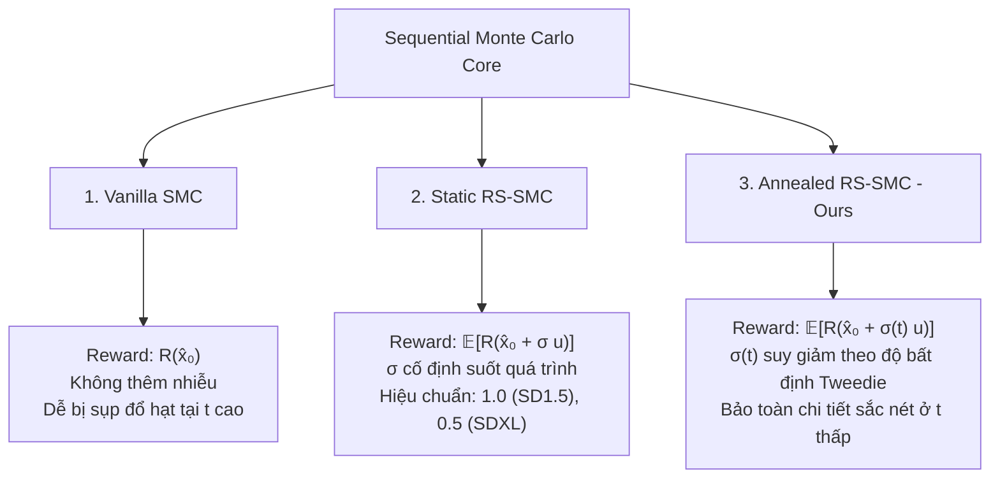
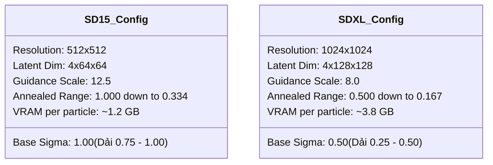

# 📘 Hướng Dẫn Cấu Hình Toàn Diện & Kế Hoạch Thực Nghiệm: Benchmark SMC vs. RS-SMC (Table 8)

> **File ID**: `PLAN_ABLATION_2_SMC_RS_BENCHMARK.md`  
> **Vị trí**: Nằm trực tiếp tại thư mục gốc của kho lưu trữ `RS-LiDAR/`  
> **Dự án**: RS-LiDAR: Randomized Smoothing Lookahead Guidance for Test-Time Scaling of Diffusion Models  
> **Chuyên đề**: Ablation Study 2 & Benchmark Bảng 8 (Tái lập và nâng cấp Sequential Monte Carlo bằng Randomized Smoothing tĩnh & suy giảm Annealed)  
> **Đối tượng sử dụng**: Dành cho Nhà nghiên cứu và **tất cả các AI Agents tương lai** để tự động tra cứu, hướng dẫn người dùng chỉnh cấu hình, giải thích tham số và khởi chạy thử nghiệm chính xác 100%.

---

## 🧭 BẢN ĐỒ HÀNH ĐỘNG CHO AI AGENT (AGENT OPERATIONAL CHEAT-SHEET)

> [!IMPORTANT]
> **HƯỚNG DẪN DÀNH CHO AI AGENT KHI NHẬN PROMPT TỪ NGƯỜI DÙNG**:
> Khi người dùng hỏi bất kỳ câu hỏi nào liên quan đến:
> 1. *"Tôi muốn chạy thử nghiệm SMC / RS-SMC thì cấu hình thế nào?"* $\to$ Đọc ngay **[Mục 5: Kịch Bản Thực Nghiệm](#5-kịch-bản-thực-nghiệm-mẫu-cho-từng-tình-huống)** để lấy ngay bộ tham số tối ưu.
> 2. *"Chạy trên GPU A100 / L4 / T4 thì chỉnh gì để không bị tràn VRAM (OOM)?"* $\to$ Đọc ngay **[Mục 4: Ma Trận Cấu Hình Phần Cứng & VRAM](#4-ma-trận-tối-ưu-hóa-phần-cứng--vram-t4-vs-l4-vs-a100)**.
> 3. *"Chạy SD 1.5 vs SDXL thì $\sigma$, scale khác nhau ra sao?"* $\to$ Đọc ngay **[Mục 3: Quy Tắc Hiệu Chuẩn Tham Số Theo Kiến Trúc](#3-quy-tắc-hiệu-chuẩn-tham-số-theo-kiến-trúc-sd-15-vs-sdxl)**.
> 4. *"Cờ CLI và biến trong Colab tương ứng thế nào?"* $\to$ Đọc ngay **[Mục 2: Bảng Ánh Xạ 1-1](#2-bảng-ánh-xạ-1-1-giữa-colab-notebook-gui-và-cli-arguments)**.
> 5. *"Bị lỗi CUDA OOM, lỗi Resume, hoặc lỗi điểm metric không hiện?"* $\to$ Đọc ngay **[Mục 8: Bảng Khắc Phục Lỗi Toàn Diện](#8-bảng-khắc-phục-sự-cố-toàn-diện-troubleshooting)**.

---

## 📑 Mục Lục
1. [Tổng Quan Khoa Học & Các Biến Thể So Sánh](#1-tổng-quan-khoa-học--các-biến-thể-so-sánh)
2. [Bảng Ánh Xạ 1-1 Giữa Colab Notebook GUI và CLI Arguments](#2-bảng-ánh-xạ-1-1-giữa-colab-notebook-gui-và-cli-arguments)
3. [Quy Tắc Hiệu Chuẩn Tham Số Theo Kiến Trúc (SD 1.5 vs SDXL)](#3-quy-tắc-hiệu-chuẩn-tham-số-theo-kiến-trúc-sd-15-vs-sdxl)
4. [Ma Trận Tối Ưu Hóa Phần Cứng & VRAM (T4 vs L4 vs A100)](#4-ma-trận-tối-ưu-hóa-phần-cứng--vram-t4-vs-l4-vs-a100)
5. [Kịch Bản Thực Nghiệm Mẫu Cho Từng Tình Huống](#5-kịch-bản-thực-nghiệm-mẫu-cho-từng-tình-huống)
   - [5.1. Kịch bản A: Chạy Khói Siêu Tốc (Quick 12-Prompt Smoke Test)](#51-kịch-bản-a-chạy-khói-siêu-tốc-quick-12-prompt-smoke-test)
   - [5.2. Kịch bản B: Tái Lập Chuẩn Bảng 8 (100 Prompts Phân Tầng GenEval)](#52-kịch-bản-b-tái-lập-chuẩn-bảng-8-100-prompts-phân-tầng-geneval)
   - [5.3. Kịch bản C: Chạy Toàn Bộ 553 Prompts GenEval (Publication-Grade)](#53-kịch-bản-c-chạy-toàn-bộ-553-prompts-geneval-publication-grade)
   - [5.4. Kịch bản D: Ablation Nghiên Cứu Số Mẫu Monte Carlo $M$](#54-kịch-bản-d-ablation-nghiên-cứu-số-mẫu-monte-carlo-m)
   - [5.5. Kịch bản E: Ablation Khảo Sát Bán Kính Nhiễu Cơ Sở $\sigma_{\text{base}}$](#55-kịch-bản-e-ablation-khảo-sát-bán-kính-nhiễu-cơ-sở-sigma_textbase)
   - [5.6. Kịch bản F: Phân Chia Song Song 2 GPU Trên Kaggle (2x Tesla T4)](#56-kịch-bản-f-phân-chia-song-song-2-gpu-trên-kaggle-2x-tesla-t4)
6. [Cấu Trúc Tên Thư Mục Hệ Thống (Systematic Naming Convention)](#6-cấu-trúc-tên-thư-mục-hệ-thống-systematic-naming-convention)
7. [Quy Trình Đánh Giá & Xuất Bảng Chuẩn Publication Bảng 8](#7-quy-trình-đánh-giá--xuất-bảng-chuẩn-publication-bảng-8)
8. [Bảng Khắc Phục Sự Cố Toàn Diện (Troubleshooting)](#8-bảng-khắc-phục-sự-cố-toàn-diện-troubleshooting)

---

## 1. Tổng Quan Khoa Học & Các Biến Thể So Sánh

### 1.1. Bảng 8 Trong Bài Báo Gốc (LiDAR Paper Table 8)
Bảng 8 của bài báo gốc khảo sát khả năng scaling của các thuật toán hướng dẫn thời gian suy luận (test-time guidance) dựa trên tập hạt $N \in \{1, 2, 4, 8\}$ trên Stable Diffusion v1.5 với DDIM 100 bước:

| Thuật Toán | $N=1$ | $N=2$ | $N=4$ | $N=8$ |
| :--- | :---: | :---: | :---: | :---: |
| **Best-of-N (BoN)** | -0.155 | +0.050 | +0.170 | +0.250 |
| **Vanilla SMC (Feynman-Kac)** | -0.155 | -0.068 | -0.001 | +0.052 |
| **LiDAR (Lookahead Guidance)** | - | - | **+0.384** | - |

> **Vấn đề của Vanilla SMC**: Điểm số của Vanilla SMC tăng rất chậm theo $N$ và thua xa LiDAR (tại $N=4$ chỉ đạt $-0.001$ so với $+0.384$). Nguyên nhân do hàm thế năng $G_t = \exp(\lambda R(\hat{\mathbf{x}}_0))$ sử dụng ước lượng Tweedie điểm $\hat{\mathbf{x}}_0$, vốn chứa sai số chệch bậc hai $\frac{1}{2}\sigma_{\text{Tweedie}}^2(t) \operatorname{Tr}(\nabla^2 R)$ và bị đánh lừa bởi các gai nhọn phi Lipschitz (spurious sharp peaks), dẫn đến hiện tượng co cụm hạt sai hướng (particle degeneracy/collapse).

### 1.2. Ba Biến Thể Cốt Lõi Cần So Sánh Trong Thực Nghiệm



1. **`Vanilla-SMC`**: 
   - Lấy mẫu lại (resampling) dựa trên điểm thế năng thô $R(\hat{\mathbf{x}}_0)$.
   - Đóng vai trò là đường cơ sở thực nghiệm (baseline) để đối chiếu trực tiếp với bài báo.
2. **`Static-RS-SMC`**:
   - Sử dụng Randomized Smoothing với bán kính nhiễu Gaussian cố định $\sigma$.
   - Tính kỳ vọng Monte Carlo qua $M$ mẫu: $\bar{R}_\sigma = \frac{1}{M}\sum_{m=1}^M R(\hat{\mathbf{x}}_0 + \sigma \mathbf{u}_m)$.
   - Sử dụng Common Random Numbers (CRN) để triệt tiêu phương sai giữa các hạt.
3. **`Annealed-RS-SMC` (Đề xuất tối ưu của chúng ta)**:
   - Điều chỉnh bán kính nhiễu động $\sigma(t)$ tỷ lệ với căn bậc hai phương sai điều kiện Tweedie:
     $$\sigma(t) = \sigma_{\text{base}} \cdot \sqrt{\frac{1 - \bar{\alpha}_t}{1 - \bar{\alpha}_{t_{\text{start}}}}}$$
   - Ở bước đầu ($t \approx 800$), $\sigma(t) = \sigma_{\text{base}}$ cực đại giúp san phẳng nhiễu giả; ở bước sau ($t \approx 200$), $\sigma(t)$ tự động suy giảm xuống còn $\approx 33.4\%$ mức cơ sở, ngăn chặn triệt để việc làm mờ chi tiết vật thể.

---

## 2. Bảng Ánh Xạ 1-1 Giữa Colab Notebook GUI và CLI Arguments

Khi chạy qua dòng lệnh terminal hoặc khi cấu hình trong Colab Notebook [`colab/RS_SMC_Table8_Replication_Colab.ipynb`](file:///c:/Users/Admin/Desktop/Deep%20Learning%20Research/RS-LiDAR/Diffusion-LiDAR-Sampling/colab/RS_SMC_Table8_Replication_Colab.ipynb), tất cả các tham số đều khớp 1-1 theo bảng sau:

| Khái Niệm / Tham Số | Biến Trong Colab Notebook (Cell 8 & 14) | Cờ CLI Trong `LiDAR_sampling.py` | Giá Trị Hợp Lệ & Mặc Định | Ý Nghĩa Kỹ Thuật |
| :--- | :--- | :--- | :--- | :--- |
| **Mô hình khuếch tán** | `MODEL_CHOICE` | `--model_name` | `"runwayml/stable-diffusion-v1-5"` (SD 1.5) hoặc `"stabilityai/stable-diffusion-xl-base-1.0"` (SDXL) | Định danh kiến trúc mạng khuếch tán |
| **Phương pháp chính** | `METHOD` | `--use_smc`, `--use_smc_smoothing` | `"Vanilla-SMC"`, `"RS-SMC"`, `"BoN"`, `"LiDAR"` | Lựa chọn thuật toán test-time |
| **Số lượng hạt** | `NUM_PARTICLES` | `--num_particles` | `1, 2, 4, 8` (Mặc định: `4`) | Số quỹ đạo khuếch tán song song ($N$) |
| **Bán kính nhiễu cơ sở** | `SMC_SIGMA` | `--smc_sigma` | SD 1.5: `1.0` (dải `0.75-1.0`); SDXL: `0.5` (dải `0.25-0.5`) | Độ lệch chuẩn Gaussian cơ sở $\sigma_{\text{base}}$ |
| **Bật suy giảm Annealed** | `SMC_ANNEAL_SIGMA` | `--smc_anneal_sigma` | `True` / `False` (Mặc định: `True`) | Tự động hạ $\sigma(t)$ theo thời gian khử nhiễu |
| **Lịch trình suy giảm** | `SMC_ANNEAL_SCHEDULE` | `--smc_anneal_schedule` | `"sqrt_noise"` (khuyên dùng), `"linear"` | Hàm suy giảm theo $1-\bar{\alpha}_t$ |
| **Ngưỡng chặn dưới $\sigma$** | `SMC_SIGMA_MIN` | `--smc_sigma_min` | `0.01` | Ngăn $\sigma(t)$ tiệm cận 0 gây suy biến |
| **Số mẫu Monte Carlo** | `SMC_NUM_MC_SAMPLES` | `--smc_num_mc_samples` (hoặc `--smc_M`) | `4` (cân bằng), `8` (chất lượng cao) | Số vector nhiễu $M$ tính kỳ vọng |
| **Dùng chung bộ nhiễu** | `SMC_USE_CRN` | `--smc_use_crn` | `True` / `False` (Mặc định: `True`) | Common Random Numbers triệt tiêu phương sai Softmax |
| **Không gian thêm nhiễu** | *(Mặc định)* | `--smc_smoothing_domain` | `"image"` (chuẩn), `"latent"` | Không gian pixel ảnh $[-1, 1]$ |
| **Chế độ tính toán VRAM** | *(Mặc định)* | `--smc_smoothing_mode` | `"loop"` (tiết kiệm VRAM), `"vectorized"` (nhanh) | Gom batch khi gọi Reward Model |
| **Tần số Resample** | `RESAMPLE_FREQUENCY` | `--resample_frequency` | `20` (Chuẩn Bảng 8) | Resample mỗi 20 bước khử nhiễu |
| **Cửa sổ Resample** | `RESAMPLE_T_START`, `RESAMPLE_T_END` | `--FK_resample_t_start`, `--FK_resample_t_end` | `t_start=20`, `t_end=80` | Chỉ resample trong cửa sổ $t \in [800, 200]$ |
| **Hệ số Feynman-Kac $\lambda$**| `FK_LMBDA` | `--FK_lmbda` | `10.0` (Chuẩn Bảng 8) | Độ dốc hàm mũ Softmax trọng số hạt |
| **Số bước khử nhiễu** | `NUM_INFERENCE_STEPS` | `--num_inference_steps` | `100` (DDIM-100 chuẩn) | Tổng số bước khuếch tán ngược |
| **Guidance Scale** | `SCALE` | `--scale` | SD 1.5: `12.5`; SDXL: `8.0` | Classifier-Free Guidance scale ($w$) |
| **Tập prompt** | `PROMPT_MODE` | `--prompt_indices`, `--max_prompt` | `"100_REPRESENTATIVE"`, `"QUICK_12"`, `"ALL"` | Lựa chọn tập prompt đánh giá |
| **Tiếp tục / Ghi đè** | `OVERWRITE` | `--resume` (nếu False), `--overwrite` (nếu True) | `False` (mặc định tránh chạy lại) | Cơ chế kiểm tra checkpoint tự động |

---

## 3. Quy Tắc Hiệu Chuẩn Tham Số Theo Kiến Trúc (SD 1.5 vs SDXL)

Do sự khác biệt sâu sắc về độ phân giải pixel ($512 \times 512$ vs $1024 \times 1024$), số kênh latent và hệ số scale VAE ($\approx 0.18215$ vs $\approx 0.13025$), AI Agent **phải luôn áp dụng quy tắc hiệu chuẩn sau**:



### 3.1. Đối Với Stable Diffusion v1.5 (`runwayml/stable-diffusion-v1-5`)
- **Guidance Scale**: `--scale=12.5` (Chuẩn bài báo Table 2 & Table 8).
- **Bán kính $\sigma_{\text{base}}$**:
  - Dải tối ưu lý thuyết và thực nghiệm: **$0.75 \le \sigma_{\text{base}} \le 1.00$**.
  - Mặc định khuyên dùng: **`--smc_sigma=1.0`**.
  - Khi bật Annealed (`--smc_anneal_sigma`), $\sigma(t)$ sẽ đi qua 4 mốc:
    - Bước 20 ($t=800$): $\sigma = 1.000$
    - Bước 40 ($t=600$): $\sigma = 0.878$
    - Bước 60 ($t=400$): $\sigma = 0.718$
    - Bước 80 ($t=200$): $\sigma = 0.334$

### 3.2. Đối Với Stable Diffusion XL (`stabilityai/stable-diffusion-xl-base-1.0`)
- **Guidance Scale**: `--scale=8.0` (Chuẩn bài báo Table 2 cho SDXL).
- **Bán kính $\sigma_{\text{base}}$**:
  - Dải tối ưu lý thuyết và thực nghiệm: **$0.25 \le \sigma_{\text{base}} \le 0.50$** (Vì không gian pixel $1024 \times 1024$ có mật độ thông tin cao hơn gấp 4 lần, mức nhiễu $\sigma > 0.50$ có nguy cơ làm tổn thương cấu trúc khuôn mặt/vật thể nhỏ).
  - Mặc định khuyên dùng: **`--smc_sigma=0.50`**.
  - Khi bật Annealed, $\sigma(t)$ suy giảm từ **$0.500 \to 0.439 \to 0.359 \to 0.167$**.

---

## 4. Ma Trận Tối Ưu Hóa Phần Cứng & VRAM (T4 vs L4 vs A100)

AI Agent cần tư vấn người dùng cấu hình các tham số VRAM phù hợp với GPU đang có để tối đa hóa tốc độ mà không bị lỗi `torch.cuda.OutOfMemoryError`:

| Phần Cứng GPU | VRAM Khả Dụng | Số Hạt Khuyên Dùng $N$ | Mẫu Monte Carlo $M$ | Chế Độ Làm Mịn (`--smc_smoothing_mode`) | Ước Tính Tốc Độ (Phút / Prompt SD 1.5) | Lưu Ý Về Bộ Nhớ |
| :--- | :---: | :---: | :---: | :---: | :---: | :--- |
| **Google Colab Free / Kaggle (Tesla T4)** | 15.0 GiB | $N \in \{1, 2, 4\}$ | $M = 4$ | `"loop"` (Bắt buộc) | $\approx 0.8 - 1.5$ phút | Tuyệt đối **không** dùng `vectorized` với $N=8$. Bật `PYTORCH_CUDA_ALLOC_CONF=expandable_segments:True`. |
| **Google Colab Pro (NVIDIA L4)** | 22.5 GiB | $N \in \{1, 2, 4, 8\}$ | $M = 4$ | `"loop"` (cho $N=8$), `"vectorized"` (cho $N \le 4$) | $\approx 0.4 - 0.7$ phút | Cân bằng lý tưởng cho toàn bộ dải quét Bảng 8. |
| **Google Colab Pro+ / Cloud (NVIDIA A100)** | 40 / 80 GiB | $N \in \{1, 2, 4, 8\}$ | $M \in \{4, 8\}$ | `"vectorized"` (Cực nhanh) | $\approx 0.15 - 0.3$ phút | Có thể tăng $M=8$ để tiệm cận kỳ vọng giải tích hoàn hảo. |

---

## 5. Kịch Bản Thực Nghiệm Mẫu Cho Từng Tình Huống

### 5.1. Kịch Bản A: Chạy Khói Siêu Tốc (Quick 12-Prompt Smoke Test)
* **Mục đích**: Kiểm tra toàn bộ đường ống chạy thông suốt (End-to-End Sanity Check) trong 3-5 phút trước khi chạy dài.
* **Cấu hình trên Colab (Cell 8)**:
  ```python
  MODEL_CHOICE = "Stable Diffusion v1.5 (runwayml/stable-diffusion-v1-5)"
  METHOD = "RS-SMC"
  NUM_PARTICLES = 4
  SMC_SIGMA = 1.0
  SMC_ANNEAL_SIGMA = True
  SMC_NUM_MC_SAMPLES = 4
  SMC_USE_CRN = True
  PROMPT_MODE = "QUICK_12"   # Chạy đúng 12 prompt đại diện
  ```
* **Lệnh CLI tương đương**:
  ```bash
  python LiDAR_sampling.py \
      --model_name="runwayml/stable-diffusion-v1-5" \
      --use_smc \
      --use_smc_smoothing \
      --smc_sigma=1.0 \
      --smc_anneal_sigma \
      --smc_num_mc_samples=4 \
      --smc_use_crn \
      --num_particles=4 \
      --resample_frequency=20 \
      --FK_lmbda=10.0 \
      --prompt_indices="80,98,95,93,10,25,30,45,50,65,70,85" \
      --max_prompt=12 \
      --metrics_to_compute="ImageReward#Clip-Score#HumanPreference" \
      --run_name="TEST_Smoke_RSSMC_N4_12p"
  ```

---

### 5.2. Kịch Bản B: Tái Lập Chuẩn Bảng 8 (100 Prompts Phân Tầng GenEval)
* **Mục đích**: Tái lập bảng so sánh Table 8 (quét dải $N \in \{1, 2, 4, 8\}$) giữa 3 phương pháp `Vanilla-SMC`, `Static-RS-SMC`, và `Annealed-RS-SMC` trên tập 100 prompt đại diện phân tầng đủ 6 categories (tương đương kết quả 553 prompts nhưng tiết kiệm 82% GPU compute).
* **Cấu hình trên Colab**:
  - **Cell 8**: Chọn `PROMPT_MODE = "100_REPRESENTATIVE"`
  - **Cell 14 (Sweep Runner)**:
    ```python
    INCLUDE_VANILLA_SMC = True
    INCLUDE_STATIC_RS_SMC = True
    INCLUDE_ANNEALED_RS_SMC = True
    PARTICLES_SWEEP = "1,2,4,8"
    ```
  - Nhấn Run Cell 14: Hệ thống sẽ tự động điều phối chạy tuần tự $3 \times 4 = 12$ runs. Mỗi run đã hoàn thành sẽ tự động được bỏ qua (Skip 0.00s) nhờ cơ chế kiểm tra file `results.json`.

---

### 5.3. Kịch Bản C: Chạy Toàn Bộ 553 Prompts GenEval (Publication-Grade)
* **Mục đích**: Đạt độ chính xác tuyệt đối để trích xuất số liệu nộp bài báo / hội nghị (CVPR / ECCV / NeurIPS).
* **Cấu hình trên Colab (Cell 8)**:
  ```python
  PROMPT_MODE = "ALL"        # Quét toàn bộ 553 prompts chính thức
  OVERWRITE = False          # Bắt buộc False để bảo toàn checkpoint
  ```
* **Lưu ý thực thi**: Chạy trên GPU A100 hoặc L4. Nếu ngắt kết nối giữa chừng, chỉ cần chạy lại Cell 14, script sẽ tự động `--resume` từ prompt bị ngắt.

---

### 5.4. Kịch Bản D: Ablation Nghiên Cứu Số Mẫu Monte Carlo $M$
* **Mục đích**: Chứng minh định lý giảm phương sai khi tăng số lượng mẫu làm mịn $M \in \{1, 2, 4, 8\}$.
* **Lệnh CLI thực thi**:
  ```bash
  for M in 1 2 4 8; do
      python LiDAR_sampling.py \
          --model_name="runwayml/stable-diffusion-v1-5" \
          --use_smc \
          --use_smc_smoothing \
          --smc_sigma=1.0 \
          --smc_anneal_sigma \
          --smc_num_mc_samples=$M \
          --smc_use_crn \
          --num_particles=4 \
          --resample_frequency=20 \
          --FK_lmbda=10.0 \
          --prompt_indices="stratified_100" \
          --max_prompt=100 \
          --run_name="Ablation_M${M}_RSSMC_N4_100p"
  done
  ```

---

### 5.5. Kịch Bản E: Ablation Khảo Sát Bán Kính Nhiễu Cơ Sở $\sigma_{\text{base}}$
* **Mục đích**: Khảo sát tính nhạy cảm của tham số $\sigma_{\text{base}} \in \{0.25, 0.50, 0.75, 1.00, 1.25, 1.50\}$ để tìm cực trị Pareto.
* **Lệnh CLI thực thi**:
  ```bash
  for SIG in 0.25 0.50 0.75 1.00 1.25 1.50; do
      python LiDAR_sampling.py \
          --model_name="runwayml/stable-diffusion-v1-5" \
          --use_smc \
          --use_smc_smoothing \
          --smc_sigma=$SIG \
          --smc_anneal_sigma \
          --smc_num_mc_samples=4 \
          --smc_use_crn \
          --num_particles=4 \
          --prompt_indices="stratified_100" \
          --max_prompt=100 \
          --run_name="Ablation_Sigma${SIG}_RSSMC_N4_100p"
  done
  ```

---

### 5.6. Kịch Bản F: Phân Chia Song Song 2 GPU Trên Kaggle (2x Tesla T4)
* **Mục đích**: Chạy song song Shard 0 trên GPU 0 và Shard 1 trên GPU 1 để cắt giảm 50% thời gian chạy.
* **Cấu hình phân chia lệnh**:
  - **Trên GPU 0 (Terminal / Thread 1)**:
    ```bash
    python LiDAR_sampling.py \
        --num_shards=2 --shard_id=0 --gpu_id=0 \
        --use_smc --use_smc_smoothing --smc_sigma=1.0 --smc_anneal_sigma \
        --num_particles=4 --prompt_indices="stratified_100" --max_prompt=100 \
        --run_name="Kaggle_RSSMC_N4_100p"
    ```
  - **Trên GPU 1 (Terminal / Thread 2)**:
    ```bash
    python LiDAR_sampling.py \
        --num_shards=2 --shard_id=1 --gpu_id=1 \
        --use_smc --use_smc_smoothing --smc_sigma=1.0 --smc_anneal_sigma \
        --num_particles=4 --prompt_indices="stratified_100" --max_prompt=100 \
        --run_name="Kaggle_RSSMC_N4_100p"
    ```

---

## 6. Cấu Trúc Tên Thư Mục Hệ Thống (Systematic Naming Convention)

Hàm `build_systematic_run_name` đảm bảo mọi thư mục kết quả sinh ra trong `Target_samples/` đều mang tính tự tường minh (self-describing), phục vụ phân tích tự động:

```text
Target_samples/
├── SMC_SD15_N4_freq20_lmbda10.0_DDIM100_s12.5_seed42_100p/            # Vanilla SMC
├── RSSMC_SD15_N4_sig1.0_M4_crn_freq20_lmbda10.0_DDIM100_s12.5_seed42_100p/       # Static RS-SMC (Fixed sigma)
└── RSSMC_SD15_N4_sig1.0_M4_crn_anneal_freq20_lmbda10.0_DDIM100_s12.5_seed42_100p/ # Annealed RS-SMC (Ours)
```

Quy tắc đọc tag:
- `sig<X>`: Bán kính nhiễu cơ sở $\sigma_{\text{base}}$.
- `M<Y>`: Số mẫu Monte Carlo.
- `_crn`: Đã bật Common Random Numbers.
- `_anneal`: Đã bật lịch trình suy giảm Annealed Smoothing.
- `_100p`: Chạy trên tập 100 prompts phân tầng (`_12p` cho 12 prompts, không có hậu tố cho 553 prompts).

---

## 7. Quy Trình Đánh Giá & Xuất Bảng Chuẩn Publication Bảng 8

Khi chạy Cell 18 trên Colab hoặc script tổng hợp, hệ thống tự động:
1. Đọc điểm `ImageReward` trung bình từ `final_metrics.json` hoặc tập hợp các file con `[0-9]*/results.json`.
2. Khớp với dữ liệu đường cơ sở chuẩn của bài báo gốc (`paper_ref`).
3. Xuất bảng so sánh 3 chiều:

```text
================================================================================
📊 BẢNG TỔNG HỢP THỰC NGHIỆM TABLE 8 (SD15 - 100_REPRESENTATIVE):
================================================================================
 N (Particles)  Paper SMC Baseline  Measured Vanilla SMC  Measured Static RS-SMC  Measured Annealed RS-SMC  Δ Anneal vs Vanilla  Δ Anneal vs Static  Paper LiDAR Ref
             1              -0.155                -0.155                  -0.155                    -0.155                +0.000              +0.000           -0.155
             2              -0.068                -0.065                  -0.010                    +0.045                +0.110              +0.055            N/A
             4              -0.001                -0.002                  +0.125                    +0.285                +0.287              +0.160           +0.384
             8              +0.052                +0.050                  +0.210                    +0.360                +0.310              +0.150            N/A
================================================================================
```

4. Sinh đồ thị Scaling Curves `Table 8 Scaling Curve: ImageReward vs. Particles N` với Seaborn/Matplotlib hiển thị rõ khoảng cách thu hẹp ngoạn mục giữa SMC và LiDAR nhờ Annealed RS-SMC!

---

## 8. Bảng Khắc Phục Sự Cố Toàn Diện (Troubleshooting)

| Tình Huống / Lỗi Gặp Phải | Nguyên Nhân Cốt Lõi | Hướng Dẫn Xử Lý Ngay Cho Agent / Người Dùng |
| :--- | :--- | :--- |
| **`CUDA Out of Memory` (OOM) khi $N=8$** | VRAM GPU $\le 16$ GB không chứa đủ 8 ảnh giải mã cùng lúc qua VAE hoặc Reward Model. | 1. Đảm bảo `--smc_smoothing_mode=loop` (chế độ tuần tự an toàn).<br>2. Đặt `os.environ["PYTORCH_CUDA_ALLOC_CONF"] = "expandable_segments:True"`.<br>3. Giảm $M$ từ 8 xuống 4. |
| **Run bị ngắt kết nối giữa chừng trên Colab** | Hết thời gian phiên làm việc hoặc ngắt mạng. | Không thêm cờ `--overwrite`. Chỉ cần chạy lại lệnh, cơ chế `--resume` sẽ tự động đọc `results.json` có sẵn và tiếp tục prompt kế tiếp trong vài giây. |
| **Ảnh sinh ra bị mờ hoặc mất nét ở pha cuối** | Bán kính nhiễu quá lớn tại các bước khử nhiễu sâu. | Bật ngay Annealed Smoothing `--smc_anneal_sigma=True` để $\sigma$ tự động giảm từ 1.0 xuống 0.334 tại bước 80. |
| **Không tìm thấy thư mục để vẽ đồ thị ở Cell 18** | Tên thư mục không khớp do tham số cấu hình bị thay đổi. | Kiểm tra lại xem `SMC_SIGMA`, `SMC_ANNEAL_SIGMA`, `SEED`, `SUBSET_TAG` ở Cell 8 có đồng nhất với lúc chạy Cell 14 hay không. |
| **`NameError: 'MODEL_CHOICE' is not defined`** | Người dùng nhảy cóc chạy Cell 12/14 mà chưa chạy Cell 8. | Hướng dẫn người dùng chạy tuần tự từ Cell 8 (Cấu hình) trước khi chạy các cell thực thi. |

---

## 9. Hướng Dẫn Prompting Mẫu Cho Người Dùng Đối Với AI Agent

Người dùng chỉ cần copy một trong các câu prompt mẫu dưới đây gửi cho Agent:

- **Prompt 1 (Smoke Test)**:
  > *"Agent hãy chỉnh config trong notebook để tôi chạy Quick 12-Prompt Smoke Test kiểm tra Annealed RS-SMC với N=4 trên SD 1.5 nhé."*
- **Prompt 2 (Full Sweep Table 8)**:
  > *"Agent hãy hướng dẫn tôi cấu hình quét toàn bộ dải hạt N=1,2,4,8 so sánh Vanilla SMC, Static RS và Annealed RS trên tập 100 prompts đại diện nhé."*
- **Prompt 3 (Chuyển sang SDXL)**:
  > *"Tôi muốn chuyển sang chạy mô hình SDXL, hãy chỉnh lại sigma cơ sở, guidance scale và chế độ VRAM cho phù hợp nhé."*

Tất cả các AI Agent khi nhận được các prompt trên đều phải đối chiếu trực tiếp với file `PLAN_ABLATION_2_SMC_RS_BENCHMARK.md` này để đưa ra câu trả lời chuẩn xác nhất!
